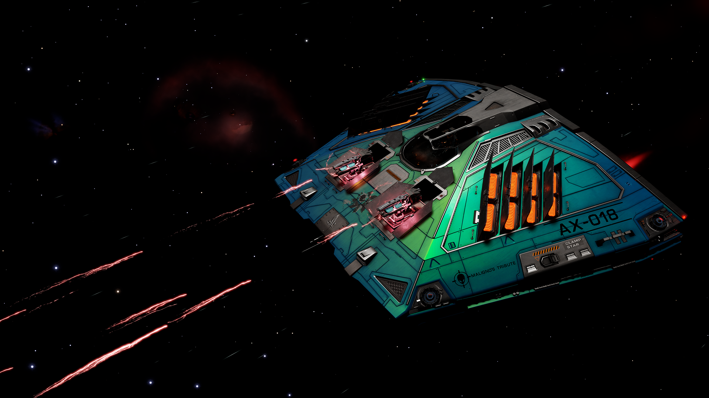
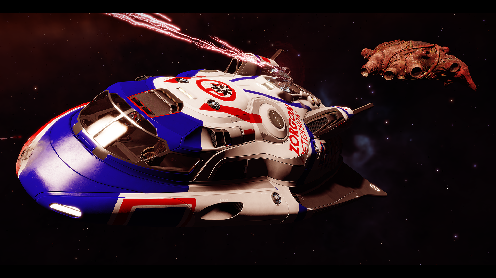
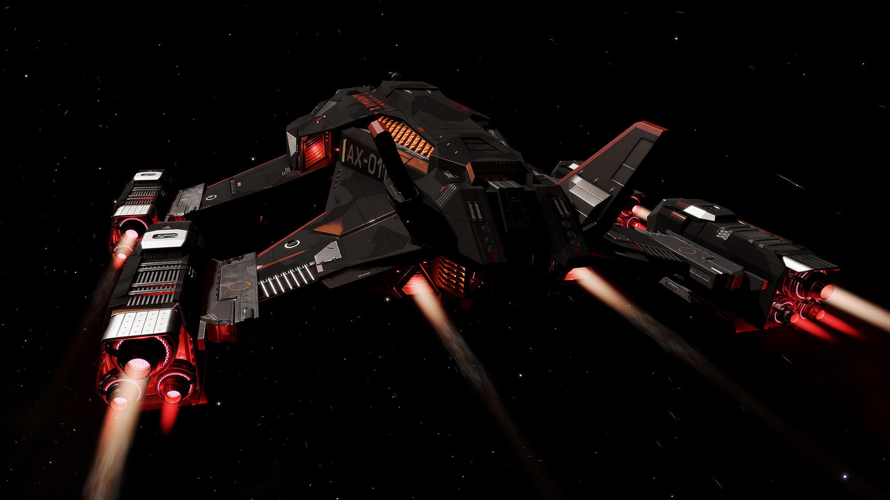

# Introduction

This page contains a list of “cursed builds” I or others have used, or tried to use, in AX combat, with varying degrees of success. It is not intended for beginners, and is not intended for general purpose use - as many of these are min/maxed builds that can do little else besides the one fight they were designed for.

Throughout these examples, I will also try to explain the concepts and principles which went into their (often highly unconventional) designs.

These are listed in descending order from “least cursed” to “most cursed.”

# Alliance Challenger: ModShard-based Instrument of Thargoid Annihilation 

|     |     |
| --- | --- |
| Ship type | Alliance Challenger |
| Ship name | AX-013 "XenoSharder" |
| Intended purpose | Ultimate “wing fighter" (which performs excellently solo as well) |
| Curse level | None (If you have an Mbooni permit); Absolute (If you don't) |
| Hardpoints | 4 “Salvation” Modified Guardian Shard Cannons  3 Small Fixed Beam Lasers: Long Range G5 + Thermal Vent |
| Fire cycle | 7400ms shards cycle; 3000ms stagger |
| Power Distributor | Class 6A: Charge Enhanced G5 + Super Conduits |
| PIPs setting | 0 SYS / 2 ENG / 4 WEP |
| Speed (laden/unladen) | 271/272 m/s orbiting, 509/512 m/s boost |
| Heat spikes | N/A (Manageable) |
| Minimum Theoretical   Time on Target   (Goid's first heart) | N/A (Short, very very short) |
| Sink Coverage Time | 150 seconds (w/ CG sinks, single-sinking) |
| Hull Value (Caustic) | 2,642.9 hp |
| Module Reinforcement Value | 525 hp @ 94%; 350 hp from first-MRP |
| Notable feats | Possibly the best general-purpose platform for modshards in the game |
| EDSY build link | [https://edsy.org/s/v7vB95Z](https://edsy.org/s/v7vB95Z) |

Build and combat notes: 

-   Currently my favorite ship in the game but absolutely cursed if you don't have the Mbooni system permit (as it is required to buy modshards)
-   At about ~510m/s top boost speed, it can nearly match a Basilisk's top speed and will easily outrun everything else
-   As a wing fighter, it kits a Shutdown Field Neutralizer in addition to three (ideally CG) heatsinks
-   With 2.6k caustic hull and excellent MRP protection, the staying power of this ship is huge - it can take a real beating while carrying on as usual
-   The only “downside” of this ship is that, despite it's light weight (for a Challenger) it still falls significantly short of the Chieftain in terms of its ability to sustain orbits (and is overall slightly slower than the Chief - a LW chief can outrun a Basilisk, the Chally generally can't). Its orbits will occasionally stall - but the CE distro with a 0-2-4 flight pattern and short boost cycle are excellent for getting out of those situations with a short boost.
-   A few variations can be explored; I personally like the build linked, but others will prefer to go with something like the below:
    -   You can drop one (or even two) fixed beams of favor of LR5/OS Cytoscramblers - you gain shield stripping power <2km but lose cooling performance and DPS >2km; Also, scouts become very time-consuming to kill without wasting shards ammo if you start dropping beams for cytos
    -   You can drop the fourth (top) shard (which also suffers from less-than-godlike convergence) in favor of a large fixed beam; at that point you CAN swap 2 (or even 3) of the other small fixed beams for 2 (or even 3) cytoscramblers, making this into a shard-based version of the popular 3m-gauss-based “CytoChally” - you gain major shield-stripping power, at the loss of a quarter of your AX damage
    -   A “solo combat” version of this ship would drop the SFN for either another heatsink or a xeno scanner, and would situationally consider trading one of the four modshards for flak
    -   I find 16t of cargo is ideal for a solo fight or a wing fighter which also wants to drop repair limpets across megaships; for an even-more-focused combat build, you can drop one of the two 8t racks and add a FOURTH MRP (though it is probably overkill)

# Hauler: Basi-capable, “Vanguard”, and “The Swarm”

|     |     |
| --- | --- |
| Ship type | Hauler |
| Ship name | AX-015 "XenoSwarmer" |
| Intended purpose | Cyclops & Basilisk solo fights; “Vanguard” and “The Swarm” challenge ranks |
| Curse level | Low (Clops, Vanguard & The Swarm); Moderate (Basilisk); |
| Hardpoints | 1 small Guardian Gauss Cannon |
| Fire cycle | 2050ms cycle |
| Power Distributor | Class 1A: Engine Focused G5 + Super Conduits |
| PIPs setting | 1 SYS / 4 ENG / 1 WEP |
| Speed (laden/unladen) | 446/466 m/s orbiting, 669/699 m/s boost |
| Heat spikes | 18.9% (1s) |
| Minimum Theoretical   Time on Target   (Goid's first heart) | Cyclops: 16 s (premium), 25 s (basic)   Basilisk: 64 s (premium) |
| Sink Coverage Time | 100 seconds (w/ CG sinks, single-sinking) |
| Hull Value (Caustic) | 748.5 hp |
| Module Reinforcement Value | 140.0 hp @ 84%; 70 hp from first-MRP |
| Notable feats | First hauler Basilisk solo kill \[CMDR Maligno\]: [https://youtu.be/8OjQz3OeraE](https://youtu.be/8OjQz3OeraE)  First duo hauler Medusa kill \[ckhrix and MalzaCAr\]: [https://youtu.be/hL3ijx09MuQ](https://youtu.be/hL3ijx09MuQ)  Trio hauler Hydra kill (QuinnRZ, Lawson FPV, and Mechan): [https://www.youtube.com/watch?v=2adGt0Hb2AI](https://www.youtube.com/watch?v=2adGt0Hb2AI) |
| EDSY build link | [https://edsy.org/s/vF013EK](https://edsy.org/s/vF013EK) |

Build and combat notes: 

-   My personal take on the general build created and popularized by CMDR ckhrix (UAAR); much of the theorycrafting behind this build is actually from him, notably the Engine-focused power distributor (I believe this is the ONLY AX build to sport such an unconventional PD.)
-   This build is notable as a single active heatsink (which produce +2 MW of WEP power for 10 seconds each, at a one-time cost of 2 MJ of SYS Cap energy) can power the single small gauss cannon that the ship can equip - freeing up the ship to fly in a 1/4/1 PIP configuration in combat. The result is an incredibly nimble and fast small ship, which can essentially permaboost using its little engine-focused distro (7.8 seconds boost cycle) noting that, even without boost, you can sustain an extremely high 466 m/s unladen orbital velocity
-   What this ship has in terms of speed and maneuverability, it lacks in terms of firepower and tank - limiting its use to lower goid variants (unless in a wing) and making it quite fragile should you accidentally find yourself in a goid's crosshairs while not under sink coverage
-   One additional positive note is that, given this ship is already at minimum weight, it is possible to give the ship a functional FSD and a proper-sized fuel tank without compromising combat performance. The result is a ship which isn't just able to fight, but can also conveniently move around various systems with a decent ~28 LY laden jump distance and ~135 LY laden jump range.
-   This build allows for arguably the easiest “Vanguard” challenge kill, as a simple cyclops is sufficient for said task, and the MTToT of this ship (using premium ammo) on a Clops is a meager 16 seconds (and, even with basic ammo, it is still a manageable 25 seconds.)
-   This ship and it's distant cousin the sidewinder are also the only two ship types allowed for “The Swarm” challenge rank; something 4 of these little ships are very well suited to handle
-   Finally, maybe the most notable and rare kill done in this ship is a solo Basilisk fight. Such fight has one of the highest MTToTs among even the most elite combat situations, at 64 seconds (with premium ammo.) It is a kill originally demonstrated by CMDR Maligno, and one very few CMDRs have emulated to-date.

# Federal Gunship: Meta Medium Speedrunner

|     |     |
| --- | --- |
| Ship type | Federal Gunship |
| Ship name | AX-019 "XenoDestroyer" |
| Intended purpose | Speedrunning Cyclops and Basilisks; potentially Medusas too |
| Curse level | Low (Clops, Basilisk); Moderate (Medusa) |
| Hardpoints | 4 Medium “Salvation” Modified Guardian Shard Cannons   1 Large Fixed Fragmentation Cannon: G4 Dual Shot + Incendiary   2 Cytoscramblers: G5 Long Rate + Inertial Impact Experimental |
| Fire cycle | Full speed shards firing |
| Power Distributor | Class 7A: Weapon Focused G5 + Super Conduits |
| PIPs setting | 0 SYS / 2 ENG / 4 WEP |
| Speed (laden/unladen) | *Doesn't really matter* |
| Heat spikes | *Doesn't really matter* |
| Minimum Theoretical   Time on Target   (Goid's first heart) | Cyclops: Instant exertion   Basilisk: Three-volley exertion |
| Sink Coverage Time | 150 seconds (w/ CG sinks, single-sinking) |
| Hull Value (Caustic) | 4,573.0 hp |
| Module Reinforcement Value | 910.0 hp @ 97%; 385 hp from first-MRP |
| Notable feats | 39s Cyclops: [https://youtu.be/0Tfe2JULUvQ](https://youtu.be/0Tfe2JULUvQ)  1m15s Basilisk: [https://youtu.be/phk08qclTj8](https://youtu.be/phk08qclTj8) |
| EDSY build link | [https://edsy.org/s/vbM4YP6](https://edsy.org/s/vbM4YP6) |

Build and combat notes: 

-   …

# Sidewinder: Solo Medusa & “The Swarm”

|     |     |
| --- | --- |
| Ship type | Sidewinder |
| Ship name | AX-018 "Maligno's Tribute" |
| Intended purpose | Medusa solo fight, using premium ammo |
| Curse level | High (Medusa) |
| Hardpoints | 2 small Guardian Gauss Cannons |
| Fire cycle | 2050ms cycle, no stagger |
| Power Distributor | Class 1A: Weapon Focused G5 + Cluster Capacitors |
| PIPs setting | 1 SYS / 2 ENG / 3 WEP |
| Speed (laden/unladen) | 252/282 m/s orbiting, 621/693 m/s boost |
| Heat spikes | 27.7% (2s) |
| Minimum Theoretical   Time on Target   (Hydra's first heart,   premium ammo) | 47 seconds |
| Sink Coverage Time | 100 seconds (w/ CG sinks) |
| Hull Value (Caustic) | 716.3 hp |
| Module Reinforcement Value | 70.0 hp @ 60%; Single MRP |
| Notable feats | Original Sidewinder vs Medusa: [https://youtu.be/dI2jbqPtpJw](https://youtu.be/dI2jbqPtpJw)  Mechan's Sidewinder vs Hydra (w/ hammergauss ammo bug): [https://youtu.be/y3s6pvANBcs](https://youtu.be/y3s6pvANBcs)  Mechan's Sidewinder vs Medusa: [https://youtu.be/PfV-BXLYoJY](https://youtu.be/PfV-BXLYoJY) |
| EDSY build link | https://edsy.org/s/voelLg5 |

Build and combat notes: 

-   Do not let the status of the Sidewinder as the underwhelming starter ship fool you. With proper engineering, and with an experienced CMDR at the helm, the Sidewinder turns into an extremely capable little ship
-   The Sidey excels at orbiting - it is only just so slightly faster than the hauler, but typically flies 1/2/3 to power it's two small gauss cannons while running on a single heatsink. Even in such configuration, it is extremely nimble and quick to settle into an orbit, and adjust without any significant risk of stalling
-   It is capable of firing the 2 small gauss together without a detectable heat spike, so long as the power distributor used is a G5 Weapon Focused with the cluster capacitors experimental. Of ALL my builds, this one is the ONLY ONE I use cluster capacitors with, and for this very specific reason; alternatively, it is totally fire to switch to a super conduits experimental and just stagger gauss fire - that works too - but personally I prefer the predictability and precision of a non-stagger firegroup here
-   The biggest downside of this build is that, due to its extremely limited internals, it can only equip a single MRP while also being quite fragile, at just above 700hp hull. Consequently, a lightning grab spells near-immediate death, and any material orbit stall will see you walking away limping and expecting a long repair period. All in all, this is a build you want to fly very defensively, privileging the avoidance of damage over (almost) anything else
-   The build is capable of taking on a Medusa, though not easily. The very first Sidey vs Medusa was accomplished by celebrated CMDR Maligno. My own ship's name and fight is a tribute to him, after he retired from active AX combat. The original version of the build by Maligno was a heavier, tankier version of the build linked here; I much prefer this one - the significantly greater agility more than compensates for the loss of a little tank. As of the time of writing (Summer 2022), only 5 CMDRs have accomplished this feat
-   The biggest challenge, in addition to and related to avoiding damage, is the comparatively long ToT required to initially exert a Medusa; at 47 seconds, it is likely to be one of the longest ones you will ever encounter. Staying in-range and on-target for that long, while avoiding damage, sustaining fire rate, and managing range, takes a lot of practice
-   With just 2 small gauss, the Sidewinder is effectively incapable of taking on a Hydra is solo combat. However, leveraging the “premium ammo bug” with the so-called hammergauss (officially “Salvation Modified Guardian Gauss Cannons”), which resulted in a +120% damage instead of the nominal +30% damage, I have demonstrated the ability of the Sidewinder to solo a Hydra in a controversial one-of-a-kind demonstration fight

# Adder: Hydra-capable “Apex Shuttle”

|     |     |
| --- | --- |
| Ship type | Adder |
| Ship name | AX-020 "Apex Subtractor" |
| Intended purpose | Hydra solo fight, using premium ammo |
| Curse level | High (Hydra) |
| Hardpoints | 1 medium + 2 small Guardian Gauss Cannons |
| Fire cycle | 2050ms cycle (double-sinking), 800ms stagger |
| Power Distributor | Class 2A: Weapon Focused G5 + Super Conduits |
| PIPs setting | 1 SYS / 1 ENG / 4 WEP |
| Speed (laden/unladen) | 251/264 m/s orbiting, 617/650 m/s boost |
| Heat spikes | 20.0% (1m) / 23.8% (2s) |
| Minimum Theoretical   Time on Target   (Hydra's first heart,   premium ammo) | 37 seconds |
| Sink Coverage Time | 50 seconds (w/ CG sinks, double-sinking) |
| Hull Value (Caustic) | 716.8 hp |
| Module Reinforcement Value | 245.0 hp @ 94%; 105 hp from first-MRP |
| Notable feats | Hydra solo kill (premium ammo) \[Mechan\]: [https://youtu.be/04jXyiaA8Do](https://youtu.be/04jXyiaA8Do) |
| EDSY build link | [https://edsy.org/s/vRj1h9f](https://edsy.org/s/vRj1h9f) |

Build and combat notes: 

-   Armed Apex Shuttle that proved (barely) capable of solo'ing a Thargoid Hydra.
-   Needs 1/1/4 pips to work, and a WF5/SC distro to avoid heat spikes, making orbiting in it quite challenging - as the Adder maneuvers poorly on just 1 ENG PIP. (A CE5/SC or even CE5/CC distro spikes quite high, resulting in a lot of damage taken. The 1 PIP in SYS is required to fire the necessary amount of sinks, as a WF5 distro doesn't have enough SYS capacity to fire all 10 without recharging)
-   The 716hp hull provides very little in terms of buffer - this is effectively a necro build as 4 limpets will repair all the way up to 100% in between runs, while doing so in less than the shield decay timer of a Hydra (5m19s.)
-   On the flip side, module protection is excellent; AFMU use is typically minimal.
-   Expect a synth-heavy fight if using this ship (ammo, limpets, sinks, some afmu.)
-   Highly recommend flying with an empty cargo hold and synthesizing limpets as needed (and dumping any extra ones before engaging) - the penalty for extra tons of weight is very significant on this ship (~4 m/s per ton orbiting velocity)

# Imperial Eagle: Medusa (Done) / Hydra (Attempting) solo fighter

|     |     |
| --- | --- |
| Ship type | Imperial Eagle |
| Ship name | AX-016 "XenoBee" |
| Intended purpose | Interceptor solo combat |
| Curse level | Moderate (Medusa) or Extreme (Hydra) |
| Hardpoints | 3 small Guardian Gauss Cannons |
| Fire cycle | 2153ms cycle, 200ms stagger |
| Power Distributor | Class 2A: Weapon Focused G5 + Super Conduits |
| PIPs setting | 1 SYS / 1 ENG / 4 WEP |
| Speed (laden/unladen) | 423/444 m/s orbiting, 725/760 m/s boost |
| Heat spikes | 22.4% (2s) / 20.4% (1s) |
| Minimum Theoretical   Time on Target   (Hydra's first heart,   premium ammo) | 60 seconds |
| Sink Coverage Time | 50 seconds (w/ CG sinks, double-sinking) |
| Hull Value (Caustic) | 513 hp |
| Module Reinforcement Value | 210.0 hp @ 94%; 70 hp from first-MRP |
| Notable feats | Medusa solo kill (premium ammo) \[Mechan\]: [https://youtu.be/BIw1ZBepnZk](https://youtu.be/BIw1ZBepnZk) |
| EDSY build link | [https://edsy.org/s/vbHTLXF](https://edsy.org/s/vbHTLXF) |

Build and combat notes: 

-   This IEagle is the absolute fastest optimized AX combat build I've ever designed; both the ViperMk3 and the iCourier, notably fast ships, are significantly slower than the IEagle in an AX combat configuration. The Hauler, using 1-4-1, can orbit slightly faster, but its boost is notably slower.
-   As a matter of fact, it can be argued that the iEagle may be even TOO fast; orbiting in the iEagle requires taking care at not going TOO FAST (you can outrun the goid's top speed with your laterals alone!), which is not something you need to worry about in any other ship
-   The ship orbits quite well overall and is almost as responsive as a Ship Launched Fighter; It's a really fun ship to fly …
-   … except for its one major, CRIPPLING issue: its single utility slot
-   Having a single utility means that A) You can't double-sink to power anything bigger than 3 small gauss; and B) Your sink coverage time is at most 50 seconds (with a CG sink.)
-   Now you will realize WHY that is an absolutely titanic problem, when you compare your sink coverage time (50s) with a Hydra first heart exert MTToT (60s) … the implication is that, put simply, you will run out of sinks on the first 3-4 hearts of a Hydra. You will need to combat-synth sinks to try and avoid that. Needless to say, combat-synthing sinks with an active 128-thargon swarm, while trying to keep a high fire rate and ideal range on a Hydra is … exceptionally hard
-   I have not managed to get past Heart 2 on a Hydra with this build myself … such a fight remains on the list of near-impossible kills
-   On the other hand, fighting a Dusa is quite doable, and a very fun and interesting challenge with this ship

# *Alliance Challenger: Human weapons only*

|     |     |
| --- | --- |
| Ship type | Alliance Challenger |
| Ship name | AX-010 "XenoWinger" |
| Intended purpose | “Snake Eater” challenge rank; Combat in HIP 22460 |
| Curse level | Moderate (Cyclops), High(Basilisk), Extreme(Medusa) |
| Hardpoints | 3 medium fixed Anti-Xeno Missile Racks   1 Large fixed Anti-Xeno Multicannon   3 Small Turreted beam laser (Long Range G5 w/ Thermal Vent) |
| Fire cycle | N/A - Max fire cycle |
| Power Distributor | Class 6A: Charge Enhanced G5 + Super Conduits |
| PIPs setting | 0 SYS / 4 ENG / 2 WEP |
| Speed (laden/unladen) | 329/331 m/s orbiting, 510/512 m/s boost |
| Heat spikes | N/A - Ship is permanently cold so long as the turrets are active |
| Minimum Theoretical   Time on Target   (Goid's first heart) | Cyclops: 5.1 s (premium), 5.6 s (basic)   Basilisk: 20.5 s (premium), 23.5 s (basic)   Medusa: 50.9 s (premium), 62.3 s (basic) |
| Sink Coverage Time | N/A - Ship is permanently cold so long as the turrets are active |
| Hull Value (Caustic) | 2,630.9 hp |
| Module Reinforcement Value | 525.0 hp @ 94%; 350 hp from first-MRP |
| Notable feats | TBD |
| EDSY build link | [https://edsy.org/s/vkE42xU](https://edsy.org/s/vkE42xU) |

Build and combat notes: 

-   With Thargoids taking over HIP 22460 and the distortion field in said system rendering guardian modules useless in a few seconds, I started tinkering with the idea of making a medium combat ship with human weapons and modules only, for use in that environment
-   As I main the Challenger in normal circumstances, that's the ship I turned to, to see if I could make a build work
-   A few core elements of “Human Build Theory” that need to be understood are as follows:
    -   Generally speaking, Anti-Xeno Missile Racks (AXMRs) do more heart-exertion damage than Anti-Xeno Multicannons (AXMCs); this is particularly true for the medium-sized variants, as the AXMRs retain the Armor Piercing value of their larger versions (and suffer only a small sustain fire rate loss given smaller magazine) while the medium-sized AXMCs have MUCH lower Armor Piercing than the large version, resulting in very poor damage.
    -   Unfortunately however, AXMRs were massively nerfed slightly after they were introduced, notably by reducing their breach damage from 20 to 0.1. What this means in practice is that it is essentially impossible to destroy Thargoid Hearts using AXMRs - for that purpose, you need to use AXMCs.
    -   For both weapon types, no gimballed version exists, and the turreted version does only a small fraction of damage of the fixed counterparts; consequently, as a general rule, these weapons should almost always be used in their fixed configuration when fighting interceptors (Thargoid Scouts are another story - against them turrets work fine and are actually optimal.)
-   As in turns out, the Challenger works very well (comparatively speaking) with 3 medium AXMRs and one large fixed AXMC. Aiming the MRs takes a lot of practice to get used to, but eventually one gets the hang of it.
-   The exceptionally low heat generation of the weapons used, coupled with the ability to run a Low Emissions plant, and three thermal vent small turreted beams, means this ship will be permanently cold, without the need for heatsinks. In this regard, it is one of the few ships which can face an interceptor without relying on heatsinks at all.
-   The Challenger retains its excellent maneuverability and perma-boost capability, making it an excellent mobile firing platform. While it cannot quite outrun a Basilisk, it gets close, and is noticeably faster than all other interceptor variants.
-   For such a mobile ship, its tank is excellent - at over 2.6k hull, and with 350 hp on its first MRP w/ 94% module protection coverage. It can take a real beating with minimal impact on its combat ability.
-   This build should be also quite capable of handling the “Snake Eater” challenge rank of the AXI; It has also been reported to be able to take down a Medusa solo …

# *Alliance Chieftain: E-Rated training ship*

|     |     |
| --- | --- |
| Ship type | Alliance Chieftain |
| Ship name | AX-011 "XenoSkillIssue" |
| Intended purpose | Training Ship; Also, Hydra-solo capable |
| Curse level | Extreme |
| Hardpoints | 4 small Guardian Gauss Cannons (Mechan's configuration)   1 medium + 3 small Guardian Gauss Cannons (Euan's configuration) |
| Fire cycle | 2054ms cycle (double-sinking), no stagger |
| Power Distributor | Class 6E: Unengineered |
| PIPs setting | 1 SYS / 1 ENG / 4 WEP |
| Speed (laden/unladen) | 173/173 m/s orbiting, 335/336 m/s boost |
| Heat spikes | 15.3% (4s) |
| Minimum Theoretical   Time on Target   (Hydra's first heart,   premium ammo) | 33 seconds |
| Sink Coverage Time | 60 seconds (w/ unengineered sinks, double-sinking) |
| Hull Value (Caustic) | 1,404.0 hp |
| Module Reinforcement Value | 577.0 hp @ 66%; 385 hp from first-MRP |
| Notable feats | Hydra solo kill (premium ammo) \[EuanAB\]: [https://youtu.be/YggrQPdUQQk](https://youtu.be/YggrQPdUQQk)  Medusa solo kill (basic ammo) \[EuanAB\]: [https://youtu.be/Vu41Z3sZe64](https://youtu.be/Vu41Z3sZe64)  Medusa solo kill (premium ammo) \[Mechan\]: [https://youtu.be/8\_3FxqDdGjY](https://youtu.be/8_3FxqDdGjY) |
| EDSY build link | [https://edsy.org/s/viqvZwj](https://edsy.org/s/viqvZwj) |

Build and combat notes: 

-   Ah, the king of cursed builds. Buy a chieftain, and kit it with the absolute worst-in-slot-options for any given module category (typically E-rated.) Forget about engineering. Then take it for a spin, and learn how much a MetaChief has hidden all your skill issues to-date.
-   This ship is maybe the very best ship to learn and practice in. Purchasing and rebuying it is dirt cheap. It requires no engineering whatsoever. It will not carry you in any way shape or form. And yet it has been proven to be Hydra-solo-capable.
-   This build actually orbits decently (for a cursed build), and has the benefit of not spiking heat at all. It's major (and, I mean, MAJOR) limitation is its speed. You will struggle for the entire duration of the fight to create distance / separation from the goid - learning to use goid rearm with your rare boost to get just barely outside of range, and for a very short time.

