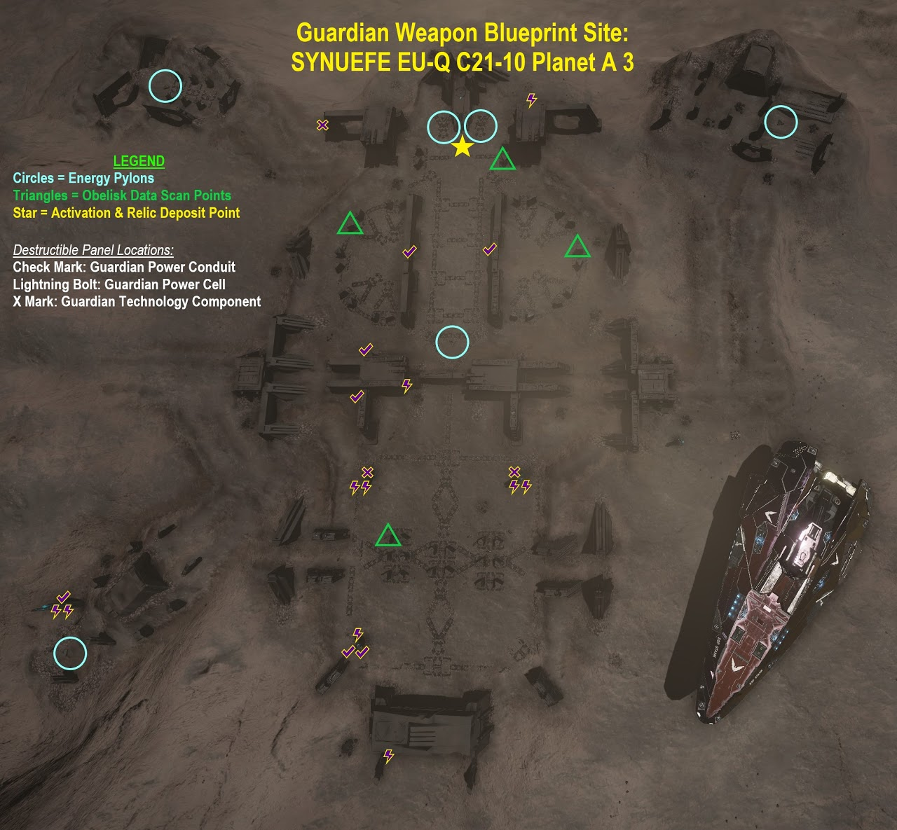
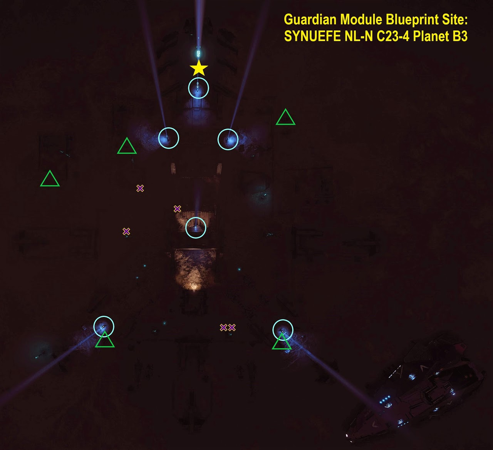

# Guardian Silahları ve Modüllerini Açmak

Guardian Modüllerini ve Silahlarını açmak için ilk önce Guardian arazilerini ziyaret edip çeşitli materyaller toplamalıyız. Bunlar; "Blueprints" (her modül için ayrı), "Components" ve "Data" olarak kategorilendirilir. Bunları toplayabilmek için SRV'ye ve iyi bir sıçrama menziline sahip bir gemiye ihtiyacınız olacak (Guardian arazileri biraz uzakta kalıyor).

**Ayrıca yedek SRV ve Point Defence modülü de getirmenizi öneriyoruz. Point Defence, Guardian Sentinel'lerin füzelerini vurup işinizi kolaylaştıracaktır (Bu füzeler önce yukarı çıkıp daha sonra sizin üstünüze doğru gelir, dolayısıyla savunmanızı yüklediğiniz slotun geminin üst kısmında kaldığına emin olun).**

Farklı Guardian arazileri farklı "Blueprint"ler verir (Modül, Silah, SLF). Blueprintleri toplamak için ilk önce; kısıtlı bir süre zarfında, birtakım direklerin içindeki güç kürelerini vurmanızı gerektiren bir mini-oyun tamamlamanız gerekecek. Tamamladıktan sonra bir adet "Ancient Relic"i alıp, mini oyuna başladığınız zemine bırakmanız gerekiyor. Bu noktada büyük bir küre ortaya çıkacak ve Data Link Scanner'ınızla taramasını yaptığınızda bir adet blueprint elde edeceksiniz. Birden fazla blueprint toplamak isterseniz, araziden uzaklaşıp ana menüye çıkıp girerek bu mini-oyunu resetleyebilirsiniz.

Bölgeyi temizlerken "Guardian Sentinel"lerle karşılaşacaksınız. Size ateş açıp takipçi füzeler fırlatacaklar. Bunlarla karşılaştıkça biriktirmeden teker teker savaşıp düşürdüğünüz sürece sorun olmayacaktır. İpucu: Sentinel'lerin mermileri sizi aynı zamanda ittirme etkisine sahiptir. Yan tarafınız dönük olduğu zaman ittirme etkisiyle aracınızı devirebileceklerinden her zaman aracınızı Sentinellere bakacak konumda tutup savaşın.

Modül ve silahları açmak için kullanabileceğiniz Guardian arazileri:

## SYNUEFE EU-Q C21-10 Gezegen A 3 (Silah)

## SYNUEFE NL-N C23-4 Gezegen B 3 (Modül)

## Video Rehber
